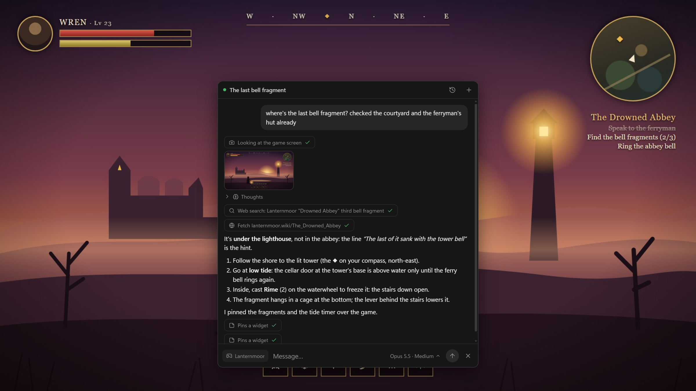
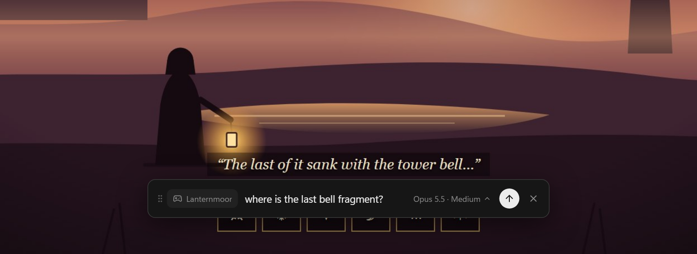
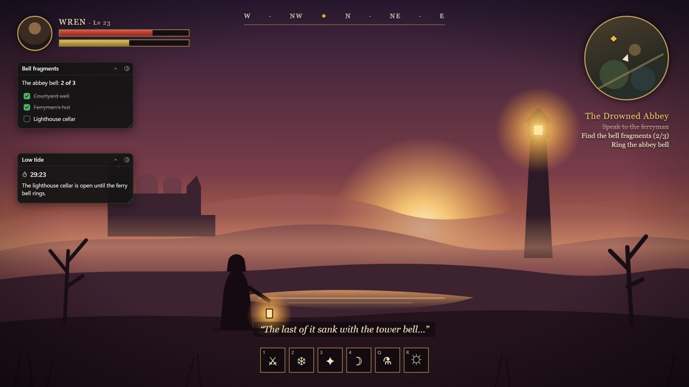
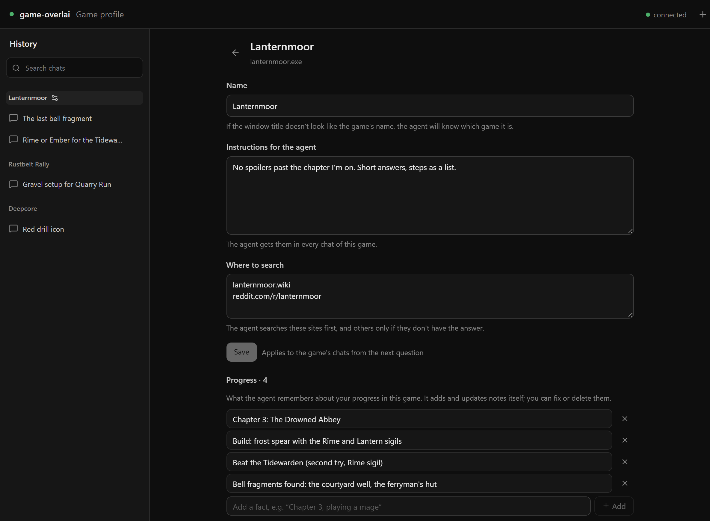
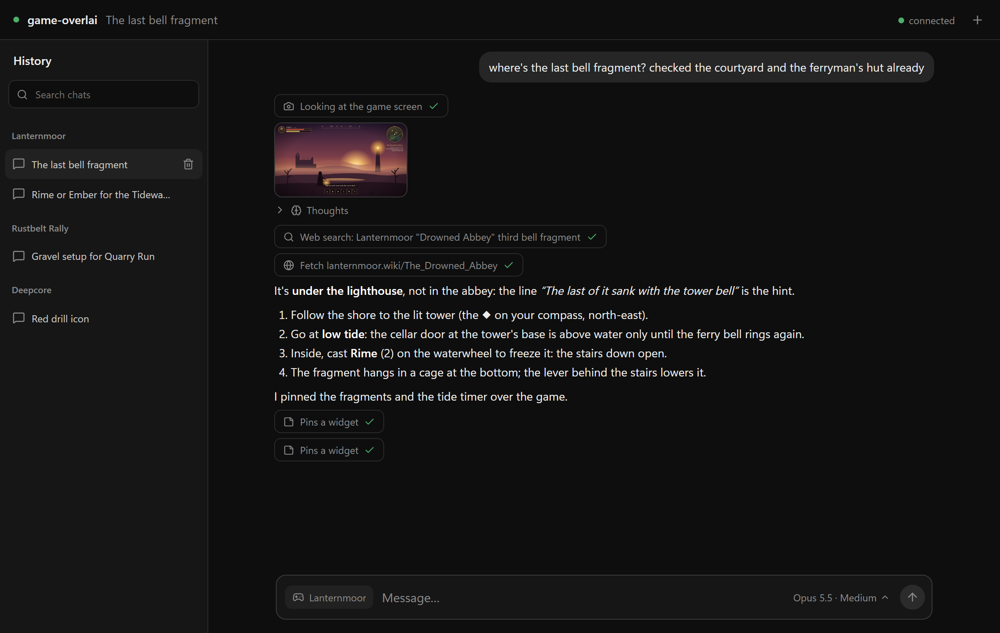
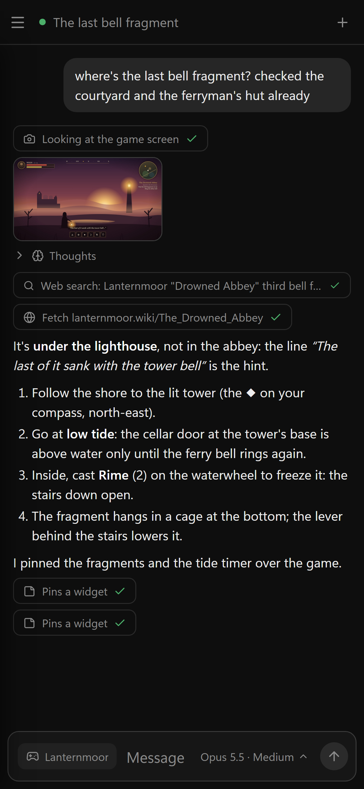
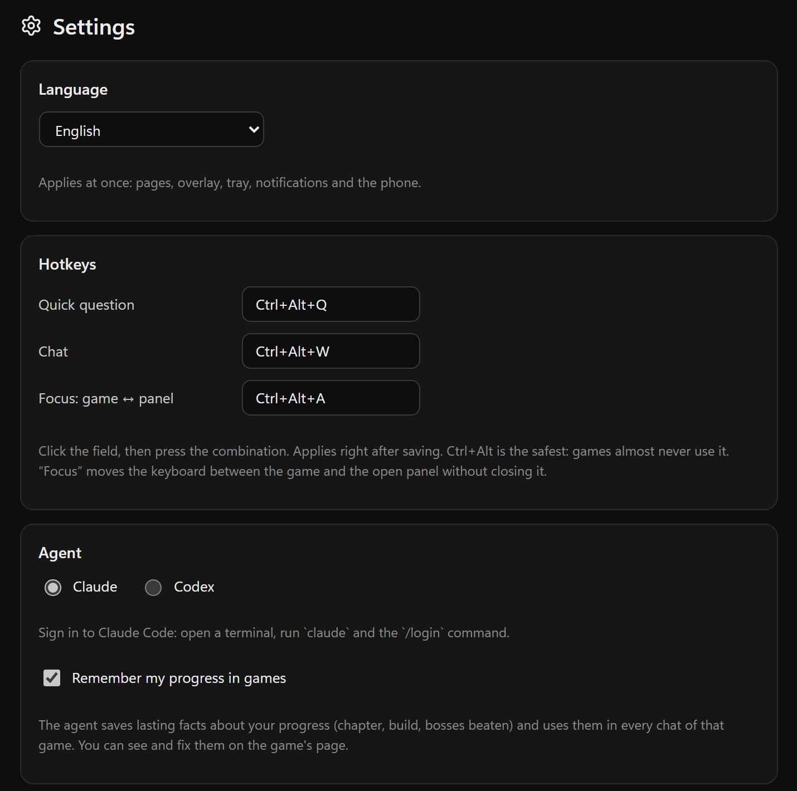

# game-overlai

Ask an AI about the game you're playing, right over the game. Press a hotkey, type a question, keep
playing: the answer shows up in a small panel on top of the game. The AI can look at your screen, search
the web, remember where you are in the game and pin notes over it. For Windows.



*The panel over a game: the agent took a look at the screen, checked the wiki and answered. (The game is
a mock-up made for these screenshots.)*

It uses an AI you already have: **Claude Code** (a Claude subscription) or **Codex** (ChatGPT). You sign
in to it once in a terminal; game-overlai needs no API keys and has no account of its own.

## What you can do with it

### Ask without leaving the game

`Ctrl+Alt+Q` opens a one-line question field over the game. Press Enter and it grows into the chat;
`Esc` hides it again, and the game gets the keyboard back. `Ctrl+Alt+W` opens the game's latest chat
instead of a new one.



The panel stays with the game it was opened over. Move it by its header, resize it by its edges and zoom it
with `Ctrl` + mouse wheel: the place and the size are remembered for each game.

### Let it look at the screen

Ask "what is this?" and the agent takes a picture of the game itself. It can also zoom into a part of the
last picture to read small text, or wait until something on the screen changes (a loading screen ends,
a dialog shows up). The pictures stay in the chat, so you can see what it was looking at.

### Pin notes over the game

The agent can pin small cards over the game window: a checklist you tick, a countdown, a short note. They
show whenever that game is in front, never take the keyboard (clicks outside them go to the game), and
stay where you drag them.
A corner button makes a card see-through, and the arrow folds it.



### Tell it about the game once

Each game has a page (click the game's name in the chat or in the browser's chat list): what to call it, what you want from the agent ("no spoilers", "I play a mage",
"answer in Spanish") and which sites to search first. While you play, the agent notes your progress
(chapter, build, bosses beaten), so you don't have to explain it again in every new chat. You can fix
or delete any note.



### Keep the chats in a browser and on your phone

All chats are also at http://127.0.0.1:47823/ in any browser, sorted by game and searchable. Handy on a
second monitor, or to read a long answer in full.





**On your phone:** tray icon → *Access from phone (Wi-Fi)*, then scan the QR code with the phone's camera.
The phone opens the same chats over your home network, so you can ask a question without touching
the game at all; the agent looks at whatever is in front on the PC.

Phone access is off until you turn it on. The QR code carries a one-time key, and devices without it
can't connect. *Reset access* on the QR page signs every phone out.

<br clear="right">

## Install

1. Install [Node.js](https://nodejs.org/) (the LTS version). The AI connectors run on it.
2. Sign in to your AI in a terminal, once:
   - **Claude Code:** install it from [claude.com/claude-code](https://claude.com/claude-code), run `claude`, then `/login`;
   - or **Codex:** install it from [github.com/openai/codex](https://github.com/openai/codex) and run `codex login`
     (then choose Codex in the settings).
3. Download `game-overlai-<version>-setup.exe` from
   [Releases](https://github.com/Kiologyn/game-overlai/releases/latest) and run it. It installs for your
   user only, without admin rights.

   The app isn't code-signed yet, so Windows may show "Windows protected your PC": press *More info* →
   *Run anyway*.
4. game-overlai starts in the tray. The first start takes a minute: it sets up the connector to your AI.

`game-overlai-<version>-portable.exe` runs without installing, but doesn't update itself: it tells you
when a new version is out and opens the download page.

## Keys

| Keys | What they do |
| --- | --- |
| `Ctrl+Alt+Q` | Quick question: a new chat |
| `Ctrl+Alt+W` | The chat panel with the game's latest chat |
| `Ctrl+Alt+A` | Moves the keyboard between the game and the open panel |
| `Esc` | Hides the panel |
| `Ctrl` + wheel, `Ctrl +` / `Ctrl −` | Zoom the panel (`Ctrl+0` resets it) |

Hotkeys are changed in the settings, for all games or for one game on its page (or turned off there). The
defaults use `Ctrl+Alt` because games almost never do. *Pause hotkeys* in the tray menu frees them for a while.

## Settings

Tray icon → *Settings…*: language, hotkeys, which AI and how it connects (proxy), panel size, picture
quality for the agent, notifications, starting with Windows and updates.



The model and its effort are picked next to the send button, from what your AI offers.

## Good to know

- **Borderless or windowed games work best.** A game in exclusive fullscreen may minimize itself when the
  panel takes the keyboard. The agent's first picture is the one taken the moment you pressed the hotkey,
  before the panel opened, so it still shows the game.
- **Nothing is injected into the game.** The panel is an ordinary window on top, and pictures come from
  Windows' own screen capture: no hooks, no DLLs.
- **The panel and the cards stay out of screenshots, recordings and streams,** so they don't end up in your
  clips (*Settings* can allow it).
- **Pictures go to your AI only when the agent takes them,** when a question needs the screen. Chats,
  pictures and notes are stored on your PC.
- **Answers while the panel is hidden:** a Windows notification tells you when an answer is ready or the
  agent asks for permission.
- **Usage:** the tray menu shows how much of your Claude Code limit is used.
- **Updates:** the app checks GitHub for a new version and only offers it: a button in the chat header,
  a line in the settings and an item in the tray menu. Updating restarts the app.
- **Your data:** chats and pictures are in `%LOCALAPPDATA%\game-overlai`, settings in
  `%APPDATA%\game-overlai\config.toml`. Uninstalling keeps both.

## Requirements

- Windows 10 or 11, 64-bit, with WebView2 (built into Windows 11; Windows 10 usually has it too)
- Node.js LTS
- Claude Code or Codex, signed in

---

## For developers

### How it's built

A Rust core (Tauri 2) and a React UI. The core shows the overlay windows, grabs game frames with Windows
Graphics Capture, keeps the history in SQLite and serves the UI over HTTP + WebSocket on
`127.0.0.1:47823`; the panel, the cards, the browser tabs and phones all run the same web app. The AI is
a CLI agent started over [ACP](https://agentclientprotocol.com/) (Claude Code / Codex adapters, a pinned
npm version installed into the app's folder); the agent's game tools (screenshot, zoom, watch, progress
notes, cards) come from the core's own MCP server.

### Building from source

| | |
| --- | --- |
| Install Rust, Node.js and the rest (winget) | `scripts\windows\setup.bat` |
| Run with hot reload (Vite + the app) | `scripts\windows\dev.bat` |
| Build the installer + portable exe into `release\<version>\` | `scripts\windows\build.bat` |

By hand: `cd web; npm install; npm run build`, then `cd src-tauri; cargo run`.

Before committing: `cargo test` and `cargo clippy` (no warnings) in `src-tauri/`, `npm run build` in `web/`.

### Layout

| Path | What |
|---|---|
| `src-tauri/src/main.rs`, `state.rs` | startup, shared app state |
| `src-tauri/src/overlay/` | the panel window: placement over the game, focus, capture exclusion (Win32) |
| `src-tauri/src/agent/` | agents over ACP: adapter install, supervision, sessions, permissions; `spec.rs` = per-agent settings |
| `src-tauri/src/chat.rs`, `history.rs` | current chat ↔ agent session, system prompt; chat history in SQLite, frames on disk |
| `src-tauri/src/games.rs`, `progress.rs` | game profiles (per exe): name, instructions, sources; progress memory |
| `src-tauri/src/widgets.rs` | cards per game and the transparent layer window over the game (click-through outside cards) |
| `src-tauri/src/capture/`, `shots.rs` | game frames: Windows Graphics Capture, JPEG encoding, storage; `look.rs` = zoom crops, change detection |
| `src-tauri/src/mcp.rs` | MCP server for the agent (`/mcp`, bearer token): frames, progress memory, cards |
| `src-tauri/src/server/` | HTTP + WebSocket servers the UI talks to: local (127.0.0.1) and LAN (token) |
| `src-tauri/src/lan.rs` | phone access: on/off, token, addresses, QR codes |
| `src-tauri/src/protocol.rs` | WebSocket protocol; TS types are generated from it |
| `src-tauri/src/proxy.rs`, `config.rs`, `tray.rs`, `hotkeys.rs` | network proxy, settings, tray, global hotkeys |
| `src-tauri/src/settings.rs`, `notify.rs` | backend of the settings page, start with Windows; notifications |
| `src-tauri/src/updates.rs`, `.github/workflows/release.yml` | new versions from GitHub Releases (Tauri updater); the release build |
| `src-tauri/src/i18n.rs`, `web/src/i18n.ts`, `web/src/locales/` | interface languages (en, ru, es, zh, ja), shared by Rust and the UI |
| `web/` | UI (Vite + React + TS): `/panel` = overlay panel, `/widgets` = cards, `/` = browser chat, `/phone`, `/settings` |
| `spikes/` | phase 0 prototypes (ACP, capture, overlay), kept for reference |

### Conventions

- After changing `protocol.rs`, run `cargo test` in `src-tauri/`: it regenerates `web/src/api/generated/`
  (don't edit those files).
- No DLL injection or hooks into game processes (anti-cheat): the overlay is a separate topmost window,
  frames come from Windows Graphics Capture.
- UI: neutral dark theme, no blue.
- UI text is never inline: `t("code")` (`useT()`) in the UI, `tr!("code", name = value)` in Rust, and the
  code goes into every `web/src/locales/*.json` (English is the base; `{name}` placeholders). `cargo test`
  checks that every used code exists and every language has it with the same placeholders. Logs and the
  agent's system prompt stay in English.

### Releases

The version lives only in `web/package.json`: `tauri.conf.json` points at it, and `build.rs` passes it to
the code as `APP_VERSION` (`Cargo.toml` keeps `0.0.0`). To release:

```powershell
cd web; npm version 0.3.0 --no-git-tag-version   # package.json + package-lock.json
# commit and push, then:
git tag v0.3.0; git push origin v0.3.0
```

The tag starts `.github/workflows/release.yml` (Windows runner). It checks that the tag is `v` + the
version, builds the NSIS installer and the portable exe, signs the installer for the updater and writes
`latest.json`, then publishes a release with notes generated from the commits. A tag with a suffix
(`v0.3.0-beta.1`) makes a pre-release, which installed copies don't see.

A dry run of the same build publishes nothing and attaches the files to the run: *Actions → Release → Run
workflow*, or `gh workflow run release.yml --ref dev`. GitHub offers it once the workflow file is on `main`.

**The updater key.** Installed copies read `releases/latest/download/latest.json` and accept an installer
only with a signature of our key for that very version (`requireSignedVersion`). The key goes into the
repository secrets `TAURI_SIGNING_PRIVATE_KEY` and `TAURI_SIGNING_PRIVATE_KEY_PASSWORD` (its public half is
`plugins.updater.pubkey`); without them a release stops. The maintainer's copy is in the git-ignored
`.tauri/`:

```powershell
Get-Content .tauri\game-overlai-updater.key -Raw | gh secret set TAURI_SIGNING_PRIVATE_KEY
Get-Content .tauri\game-overlai-updater.password -Raw | gh secret set TAURI_SIGNING_PRIVATE_KEY_PASSWORD
```

Keep a backup: with the key lost, installed copies can't take updates any more, only a manual reinstall.

### Settings file

`%APPDATA%\game-overlai\config.toml` is created on the first start; a missing key means its default, and
the settings page rewrites the file. A few keys worth knowing:

- `[network] proxy = "system"` takes the Windows proxy (PAC included), else `HTTP(S)_PROXY`, else none;
  `require_proxy_for = ["claude"]` refuses to start that agent without a proxy.
- `[agent_options.<agent>]`: the model and effort picked in the chat, for every session of that agent.
- `[capture] agent_max_height = 720`: pictures go to the agent scaled to this height (0 = full size, never
  over 2000 px a side); saved ones stay full size.

In `%LOCALAPPDATA%\game-overlai\`: `history.db` (chats, game pages, progress notes, cards, panel places),
`shots\` (pictures, deleted with their chat), `lan.json` (phone access and its key), `agents\` (the ACP
adapters), `logs\`.

### Debug switches

| Variable | Effect |
| --- | --- |
| `OVERLAI_LOG=debug` | more detailed logs |
| `OVERLAI_UI_DEV=http://localhost:5173` | the UI from Vite (what `dev.bat` does) |
| `OVERLAI_DEBUG_SHOW=compact\|expanded` | opens the panel 1.5 s after the start |
| `OVERLAI_DEBUG_CAPTURABLE=1` | the panel shows up in screenshots |
| `OVERLAI_LAN_ADDR=127.0.0.1` | the phone server on this PC only (tests without the firewall prompt) |
| `OVERLAI_UPDATE_URL=http://127.0.0.1:8000/latest.json` | checks that file instead of the GitHub release (http: debug builds only) |
